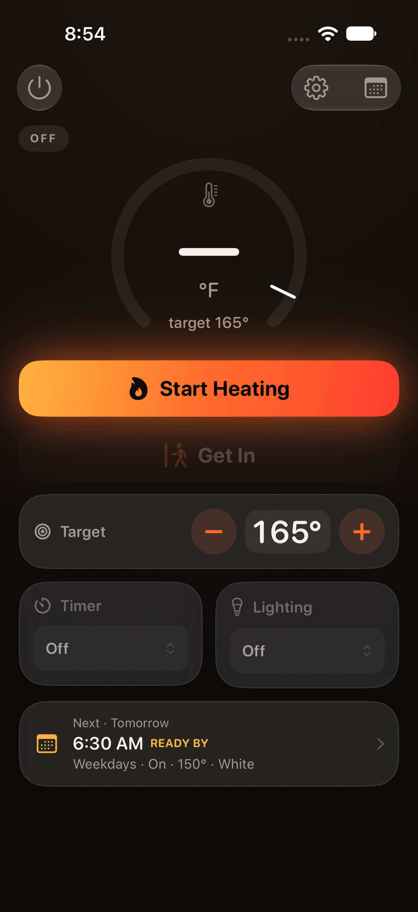
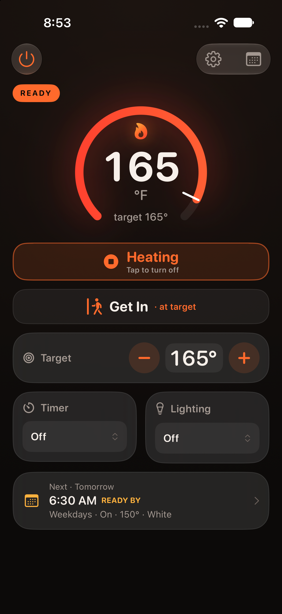
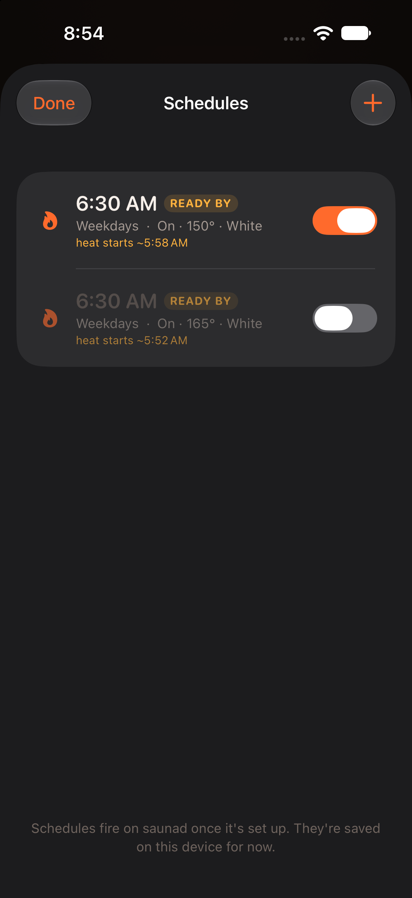

# IOS Sauna Controller — Finnmark FD‑5

A native **iPhone app** plus a small **home bridge** for controlling a **Finnmark FD‑5**
(Tuya‑based) infrared sauna entirely over your **local network** — no OEM cloud, live
temperature, one‑screen control, session logging, Apple Health, and an in‑app warm‑up scheduler.

> **Forked from [ember](https://github.com/mattsmcnulty/ember)** by Matt McNulty (MIT), which
> was built for a **Sun Home Eclipse 2**. This project keeps ember's architecture (a pure‑Swift
> app that talks only to a local Python bridge) and **remaps everything to the Finnmark FD‑5** —
> a different Tuya device with its own datapoint map, light palette, and quirks. For the deep
> reverse‑engineering backstory (getting the `localKey`, the Tuya LAN v3.5 handshake, the
> momentary‑toggle gotchas), see the **[original ember README](https://github.com/mattsmcnulty/ember)**.

<p align="center">
  
  &nbsp;
  
  &nbsp;
  
</p>

---

## What it does

- **Control screen** — power, start/stop heat, a temperature dial, a tap‑to‑type **target**,
  and compact **Timer** and **Lighting** dropdowns. Everything on one screen, no scrolling.
- **Status at a glance** — a **preheat ETA** ("ready in ~N min", from a learned heat‑up rate)
  and the **next scheduled** warm‑up, shown together.
- **Get In / Get Out** — one tap starts a session (applies your default scene) and logs it;
  Get Out ends it, records the session, and writes an **Apple Health** workout.
- **Live Activity** — live cabin temperature and status on the Lock Screen / Dynamic Island
  (via APNs), with an on‑device session timer.
- **Scheduler** *(in progress)* — an in‑app "cron GUI": weekly or one‑time schedules that set
  power / target / light / timer, including a **"ready by"** mode that back‑calculates the start
  time from a **learned** preheat rate. Schedules are stored on‑device today; actually *firing*
  them moves to `saunad` (see below).
- **Defaults & presets** — a default target / timer / light applied on start, and an editable
  list of quick‑pick timer durations, all in Settings.
- **HomeKit** *(optional)* — a Homebridge plugin exposes the sauna as a thermostat + lights +
  power switch.

The audio in the FD‑5 is **Bluetooth** and controlled at the cabin / from your phone directly —
it is not on the Tuya API, so the app intentionally has no speaker controls.

---

## Architecture

The iOS app **never speaks Tuya.** It only talks to `saunad` over plain HTTP on your LAN;
`saunad` owns the sauna's single Tuya socket and pushes Live Activity updates via APNs.

```
┌────────────┐   HTTP/JSON over the LAN     ┌──────────────────┐   Tuya LAN v3.5   ┌──────────┐
│  iOS app   │  GET /state  POST /control   │  saunad          │   (AES‑GCM,       │  Finnmark│
│ (SwiftUI)  │ ───────────────────────────▶ │  Python, on an   │   single conn,    │  FD‑5    │
│            │ ◀─────────────────────────── │  always‑on box   │   reconnect/poll) │  (Tuya)  │
└─────┬──────┘   POST /activity/token        └────────┬─────────┘ ────────────────▶ └──────────┘
      │  Live Activity (Lock Screen /                  │  APNs (.p8 / ES256)
      ▼  Dynamic Island)  ◀───── APNs ◀──────── api.push.apple.com
```

- **`app/`** — SwiftUI app (iOS 26, Swift 6). Talks only to `saunad`; renders the Live Activity.
- **`saunad/`** — Python ([FastAPI](https://fastapi.tiangolo.com) +
  [tinytuya](https://github.com/jasonacox/tinytuya)) bridge on any always‑on box. Sole owner of
  the sauna's single Tuya LAN socket; exposes a small HTTP API; pushes Live Activity updates via
  APNs. Full setup + API in **[`saunad/README.md`](saunad/README.md)**.
- **`homebridge-sauna/`** — a TypeScript **Homebridge plugin** (platform `FinnmarkSauna`) that
  puts the sauna in **HomeKit** as another HTTP client of `saunad`.
  See **[`homebridge-sauna/README.md`](homebridge-sauna/README.md)**.

**Why a bridge:** iOS can't poll a LAN device in the background often enough for a live readout,
and the Tuya device allows **only one** local connection at a time — so a single always‑on owner
is mandatory. It also keeps the shipped app pure‑Swift with **no Tuya crypto**.

---

## FD‑5 datapoint map

Remapped and verified hands‑on for the Finnmark FD‑5 (these differ from the Eclipse 2 in ember).

| DP | Meaning | Type | Notes |
|---|---|---|---|
| **102** | power | bool | cabin power; writing a color/timer only sticks while powered on |
| **101** | heater | bool | the heating element (comes up off after a power‑on) |
| **107** / 104 | target °F / °C | int | setpoint, 86–170 °F |
| **108** / 106 | current °F / °C | int, read‑only | stale/absent while powered off |
| **105** | timer | int (min) | writable **and** counts down while running (set == remaining), 0–90 |
| **109** | unit | bool | true = °F |
| **111** | light | enum | `White · Purple · Blue · Cyan · Green · Yellow · Red · Scroll · Orange · Magenta · Off` — applies only while powered on; a power‑on resets it to White |

---

## Repo layout

```
app/                 # iOS app (SwiftUI, iOS 26, Swift 6) — xcodegen project
  project.yml        #   xcodegen spec (targets, signing, build configs)
  Sources/           #   RootTabView, ControlView, SchedulesView, Settings, Models, Net, Activity, Health
  Shared/            #   ChromaPalette + Live Activity attributes (shared app ⇄ widget)
  Widget/            #   Live Activity UI (Lock Screen + Dynamic Island)
saunad/              # Python bridge (FastAPI + tinytuya + APNs) — see saunad/README.md
homebridge-sauna/    # HomeKit via Homebridge (TypeScript) — FinnmarkSauna platform
tools/               # local reverse‑engineering / device scratch (gitignored contents)
```

Secrets — the Tuya `localKey`, the `saunad` `apiKey`, and the APNs `.p8` — live in **gitignored**
files (`saunad/options.json`, `tools/.../devices.json`, `*.p8`). Nothing device‑specific is
committed.

---

## Build & run

1. **Get your `localKey`.** LAN control needs *your* device's `devId` + 16‑byte `localKey` + LAN
   IP. Try the [tinytuya wizard](https://github.com/jasonacox/tinytuya#setup-wizard) first; if
   the device never appears in Smart Life (OEM‑locked), read the key from the OEM app at runtime
   (Android emulator + [Frida](https://frida.re), no re‑pair). The key **rotates** on re‑pair.
2. **Run `saunad`** on an always‑on box and point it at your device — see
   [`saunad/README.md`](saunad/README.md).
3. **Build the app** with [XcodeGen](https://github.com/yonaskolb/XcodeGen):
   `cd app && xcodegen generate && open SaunaController.xcodeproj`, then set your signing team and
   run. In the app's Settings, set the saunad **Address** (`http://<bridge-ip>:8765`).

A `Debug-FreeTeam` build config is included for installing on a device with a **free** Apple ID
(it drops the Push / HealthKit entitlements a free team can't provision).

---

## Scope & safety

Personal project. It controls **one specific sauna on its owner's own network**. The device key
is per‑user config kept out of git; nothing reverse‑engineered ships in the app.

**This controls a heating appliance. No warranty — use at your own risk.** Not affiliated with
Finnmark, Sun Home Saunas, Edge Theory Labs, or Tuya.

---

## License & credits

MIT — see [`LICENSE`](LICENSE). Built on **[ember](https://github.com/mattsmcnulty/ember)** by
Matt McNulty (MIT); all the original work on the Tuya LAN approach, Live Activity plumbing, and
the app's foundations is his. This fork adapts it to the Finnmark FD‑5.
